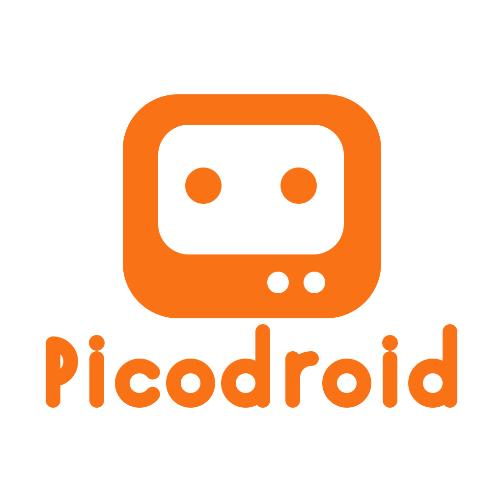
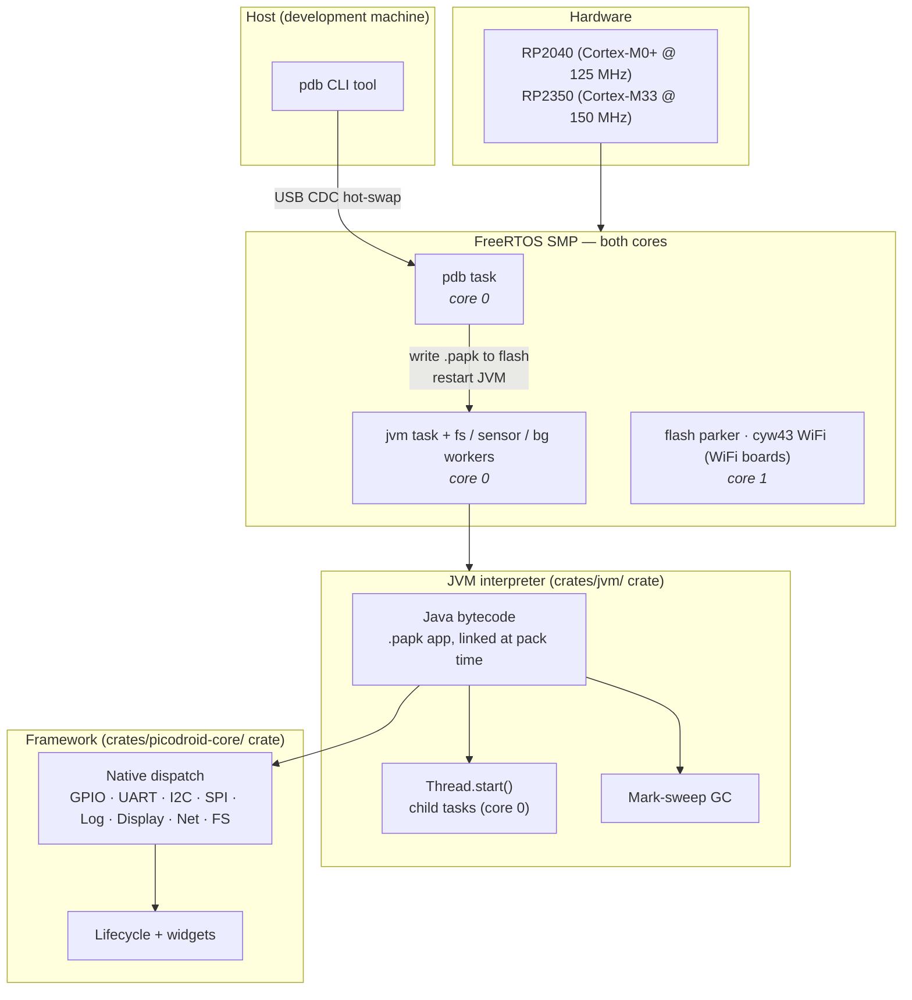

<p align="center">
  
</p>

<p align="center">
  <a href="https://github.com/shivrajora/picodroid-rs/actions/workflows/ci_checks.yml"></a>
  
  
</p>

<p align="center">
  <a href="https://shivrajora.github.io/picodroid-rs/"><b>Documentation</b></a>
</p>

# Picodroid

A stripped-down, FreeRTOS-based version of Android for the Raspberry Pi Pico.

Apps are written in Java, compiled to bytecode, and interpreted by a lightweight JVM built in Rust — running directly on bare-metal embedded hardware.

## What is Picodroid?

| Layer | Technology |
|-------|-----------|
| Hardware | Raspberry Pi Pico (RP2040, dual Cortex-M0+ @ 125 MHz), Pico 2 (RP2350, dual Cortex-M33 @ 150 MHz) and Pico 2 W (RP2350 + CYW43439 WiFi), on seven boards from a bare testbench to the Enviro+ pack, the Display Pack 2.0 and a 320x480 touch kit |
| RTOS | FreeRTOS SMP — both cores active (via [freertos-rust](https://github.com/shivrajora/FreeRTOS-rust)) |
| Runtime | Custom JVM interpreter in Rust (`crates/jvm/`); classes linked at pack time, natives dispatched by name hash, a mark-sweep GC |
| Java API | Named to mirror `android.*`: `picodroid.app.Activity` / `Service` / `Fragment` with the lifecycle and back stack, `picodroid.lifecycle.ViewModel` / `LiveData`, `picodroid.widget.*` and `picodroid.view.*` (LVGL-backed, with XML layouts, `R`, themes, `Canvas`, `ViewPager2`, dialogs, toasts, the soft keyboard), `picodroid.content` (`Intent`, `SharedPreferences`, `PackageManager`, `ConnectivityManager`), `picodroid.io` and `java.io` (LittleFS files, streams, readers), `picodroid.net` (TCP/UDP, `HttpURLConnection`, HTTPS over TLS 1.3), `picodroid.json` / `picodroid.protobuf`, `picodroid.hardware.SensorManager`, `picodroid.pio` (GPIO, I2C, SPI, UART, PWM, ADC), `picodroid.media`, `java.time`, `java.util.concurrent`, `AlarmManager`, `Settings` |
| Apps | Java or Kotlin, compiled by Gradle into a `.papk`; hot-swapped over USB with `pdb`; several apps per board behind a launcher and a settings app |
| Logging | [defmt](https://defmt.ferrous-systems.com/) over RTT |

### Architecture



Apps are hot-swapped at runtime with `pdb install`, without reflashing the firmware. [ARCHITECTURE.md](ARCHITECTURE.md) is the map behind the picture; the same page is on the site as [Architecture](https://shivrajora.github.io/picodroid-rs/project/architecture/).

## Hardware

- A Raspberry Pi Pico (RP2040), Pico 2 (RP2350) or Pico 2 W (RP2350 + CYW43439), bare or on one of the supported carriers: the Pimoroni Enviro+ Pack (`pico_enviro_mon`, `_w`), the Pimoroni Display Pack 2.0 (`pico_display2_w`) or the 52Pi 3.5" touch kit on a Pico Plus 2 W (`pico_touch_kit`). The three `testbench_*` boards describe the bench wiring. Every RP2350 board is a multi-app board with the launcher and settings built in; `testbench_rp2040` runs one app.
- An SWD debug probe: [Raspberry Pi Debug Probe](https://www.raspberrypi.com/products/debug-probe/), Picoprobe, J-Link, or any CMSIS-DAP adapter

On the WiFi boards the `picodroid.net` stack runs over WiFi end-to-end — WPA2/WPA3 join, DHCP, TCP/UDP sockets, HTTP and HTTPS — validated on hardware, and the platform sets the clock from NTP. See [WiFi & networking setup](https://shivrajora.github.io/picodroid-rs/get-started/networking/) for build-time credentials, Settings → Wi-Fi, and the required cyw43 submodule fork; the board table is under [Choosing a board](https://shivrajora.github.io/picodroid-rs/get-started/build/#choosing-a-board).

## Quick Start

```bash
git clone --recurse-submodules https://github.com/shivrajora/picodroid-rs
cd picodroid-rs
./scripts/build.sh --app helloworld
./scripts/flash.sh --app helloworld
```

After flashing, push a new app over USB CDC without reflashing:

```bash
./scripts/pdb.sh devices                        # every board and simulator, by serial
./scripts/pdb.sh -d install build/apks/blinky.papk   # the one USB device; or -s <serial>
./scripts/pdb.sh -d sysmon                      # heap, tasks, CPU usage
```

A board is addressed by its serial number, as with `adb`; a port (`/dev/ttyACM*` on Linux, `/dev/cu.usbmodem*` on macOS) works in its place.

No board yet? The host simulator runs the same firmware against your machine's display and network, and is a `pdb` device too:

```bash
./scripts/sim.sh --app displaydemo              # opens a window, mouse as touch
```

See [Build & flash](https://shivrajora.github.io/picodroid-rs/get-started/build/) for prerequisites, board and app selection and UF2 flashing, and [Host simulator](https://shivrajora.github.io/picodroid-rs/get-started/simulator/) for the sim.

## Documentation

The full docs are published at **<https://shivrajora.github.io/picodroid-rs/>** — searchable, cross-linked, and deployed from [`website/`](website/) by [`.github/workflows/docs.yml`](.github/workflows/docs.yml) on every push to `main`. The same content also renders on GitHub directly under [`website/src/content/docs/`](website/src/content/docs/).

**New to Picodroid? Read in this order:** [Build & flash](https://shivrajora.github.io/picodroid-rs/get-started/build/) → [Your first app](https://shivrajora.github.io/picodroid-rs/get-started/first-app/) → [Multi-screen tutorial](https://shivrajora.github.io/picodroid-rs/tutorials/multi-screen-app/) → [Embedded gotchas](https://shivrajora.github.io/picodroid-rs/guides/embedded-gotchas/) → [Limits & memory budgets](https://shivrajora.github.io/picodroid-rs/reference/limits/).

- [Get started → Build & flash](https://shivrajora.github.io/picodroid-rs/get-started/build/) — prerequisites, build, flash, board/app selection
- [Get started → Host simulator](https://shivrajora.github.io/picodroid-rs/get-started/simulator/) — run apps without hardware
- [Get started → Hot-swap with pdb](https://shivrajora.github.io/picodroid-rs/get-started/hot-swap/) — push PAPKs over USB CDC
- [Get started → Your first app](https://shivrajora.github.io/picodroid-rs/get-started/first-app/) — Application/Activity lifecycle and supported language features
- [Tutorials](https://shivrajora.github.io/picodroid-rs/tutorials/multi-screen-app/) — guided builds: a [multi-screen app](https://shivrajora.github.io/picodroid-rs/tutorials/multi-screen-app/) and a [background service](https://shivrajora.github.io/picodroid-rs/tutorials/background-service/)
- [Java API](https://shivrajora.github.io/picodroid-rs/api/) — split by area: [core](https://shivrajora.github.io/picodroid-rs/api/core/), [system](https://shivrajora.github.io/picodroid-rs/api/system/), [services](https://shivrajora.github.io/picodroid-rs/api/services/), [peripherals](https://shivrajora.github.io/picodroid-rs/api/peripherals/), [storage](https://shivrajora.github.io/picodroid-rs/api/storage/), [networking](https://shivrajora.github.io/picodroid-rs/api/networking/), [sensors](https://shivrajora.github.io/picodroid-rs/api/sensors/), [UI](https://shivrajora.github.io/picodroid-rs/api/ui/)
- [Java API](https://shivrajora.github.io/picodroid-rs/api/) (continued) — [JSON](https://shivrajora.github.io/picodroid-rs/api/json/), [protobuf](https://shivrajora.github.io/picodroid-rs/api/protobuf/), [audio](https://shivrajora.github.io/picodroid-rs/api/media/)
- [Guides](https://shivrajora.github.io/picodroid-rs/guides/embedded-gotchas/) — [embedded gotchas](https://shivrajora.github.io/picodroid-rs/guides/embedded-gotchas/), [Kotlin apps](https://shivrajora.github.io/picodroid-rs/guides/kotlin/), [apps on every board](https://shivrajora.github.io/picodroid-rs/guides/every-board/), [button-only navigation](https://shivrajora.github.io/picodroid-rs/guides/button-navigation/), [the launcher](https://shivrajora.github.io/picodroid-rs/guides/launcher/), [debugging](https://shivrajora.github.io/picodroid-rs/guides/debugging/), [troubleshooting](https://shivrajora.github.io/picodroid-rs/guides/troubleshooting/), [bundled image assets](https://shivrajora.github.io/picodroid-rs/guides/assets/), [resources and XML layouts](https://shivrajora.github.io/picodroid-rs/guides/resources/), [theming](https://shivrajora.github.io/picodroid-rs/guides/theming/)
- [Reference](https://shivrajora.github.io/picodroid-rs/reference/limits/) — [limits & memory budgets](https://shivrajora.github.io/picodroid-rs/reference/limits/), [known issues](https://shivrajora.github.io/picodroid-rs/reference/known-issues/), the [Android compatibility matrix](https://shivrajora.github.io/picodroid-rs/reference/compatibility-matrix/), the [manifest schema](https://shivrajora.github.io/picodroid-rs/reference/manifest/), [pdb commands](https://shivrajora.github.io/picodroid-rs/reference/pdb-commands/), the [shrinker](https://shivrajora.github.io/picodroid-rs/reference/shrinker/), [JVM tunables](https://shivrajora.github.io/picodroid-rs/reference/jvm-tunables/), the [porting guide](https://shivrajora.github.io/picodroid-rs/reference/porting-guide/)
- [Release notes](https://shivrajora.github.io/picodroid-rs/project/release-notes/) — v0.4.0 → v0.37.0, and what is on `main` since
- [Contributing](CONTRIBUTING.md) — how to contribute, run tests, and add new features

Working *on* Picodroid rather than with it? The engineering record — designs, audits, roadmaps and dated bug investigations — is indexed at [`docs/README.md`](docs/README.md), which routes by subsystem and marks what is landed, open or not started.

## Project Structure

Three rules place every directory: `crates/` holds the Rust libraries,
`platforms/` the firmware binaries, `tools/` the host binaries, and `sdk/`
everything an app's build compiles against.

```text
picodroid-rs/
├── crates/             # Rust libraries — no binaries, no board knowledge below picodroid-core
│   ├── jvm/            # JVM interpreter (pico-jvm); no_std + alloc only, no hardware deps
│   ├── picodroid-core/ # Family-neutral framework: JVM natives, lifecycle, graphics,
│   │                   # networking, install, host-simulator HAL, and porting.rs
│   │                   # (the checklist a new MCU family implements). Owns the C configs it
│   │                   # compiles: freertos-host/, net-freertos-tcp/
│   ├── class-link/     # Pack-time link tables and the class section (PAPK v3, Utf8 pool)
│   ├── papk-format/    # PAPK container format — single source of truth (firmware + tools)
│   ├── pdb-protocol/   # PDB wire format shared by firmware, simulator, and the pdb CLI
│   ├── compat/         # PAPK ↔ firmware framework-map-version compatibility check
│   ├── pd-rtos/        # The kernel seam: the Rtos trait and the JVM run lock
│   ├── pd-install/     # Streaming, CRC-checked installer into a NOR flash region
│   ├── pd-lvgl-sys/    # no_std LVGL 9.6 bindings plus the C build (lvgl/lv_conf.h)
│   ├── pd-drivers/     # embedded-hal drivers: ST7789/ST7796, XPT2046/GT911, BME688/LTR559
│   ├── pd-json/        # Bounded no_std JSON tree behind picodroid.json
│   ├── pd-tls/         # TLS 1.3 client pieces behind has_tls
│   ├── http-head/      # no_std HTTP/1.1 head parser and chunked decoder
│   ├── heap4/          # FreeRTOS heap_4 port, for host-side heap parity
│   ├── build_support/  # Shared build-script logic (boards, FreeRTOS, LVGL, network, names,
│   │                   # PAPK embed), #[path]-included by the build.rs files
│   └── test_support/   # Source-scan guards shared by the core and platform test suites
│
├── platforms/
│   └── rp/             # RP-family firmware crate (RP2040 + RP2350) — the binary
│       ├── boards/     # Board configs (testbench_rp2040 / _rp2350 / _rp2350w, pico_enviro_mon / _w, pico_display2_w, pico_touch_kit)
│       ├── mcus/       # Per-MCU linker scripts, FreeRTOS config, heap sizes
│       └── src/        # Boot tasks, RP HAL (hal/rp/ + port/ C shims), pdb transport, flash slot
│
├── tools/              # Host binaries
│   ├── papk-pack/      # Packages and links compiled .class files into a .papk file
│   ├── papk-info/      # Inspects .papk contents (manifest, classes, sizes)
│   ├── class-shrink/   # Class/member-name shrinker — release maps, per-app maps, retrace
│   ├── pdb/            # Picodroid Debug Bridge: devices by serial, install, input, sysmon, logcat
│   ├── protoc-gen-picodroid/  # protoc plugin (Python) that generates picodroid.protobuf classes
│   └── kotlin-survey/  # Standalone Gradle build: what kotlinc emits for a picodroid app
│
├── sdk/                # Everything an app build consumes
│   ├── java/           # Android-compatible Java API (picodroid.*), compiled into firmware Flash
│   ├── kotlin-shim/    # kotlin/** stdlib shim packed into Kotlin apps' PAPKs (:kotlin-shim)
│   ├── inject/         # javax.inject annotations + the annotation processor (:inject:*)
│   ├── shrink-maps/    # Immutable per-release shrink maps (v<semver>.toml)
│   ├── keep.toml       # Shrinker keep list
│   ├── *.tsv           # Generated name lists behind the runtime's c::/m::/d:: constants
│   └── PicodroidManifest.xsd   # Manifest schema, for editors (the build validates in Kotlin)
│
├── examples/           # Example apps (Java or Kotlin sources + a PicodroidManifest.xml)
├── system-apps/        # Apps linked into every multi-app firmware: the launcher, settings
│
├── buildSrc/           # Gradle convention plugins: PAPK packing, shrinking, contract checks
├── gradle/  gradlew    # Gradle wrapper
│
├── scripts/            # Build, flash, sim, pdb, test, HIL and pre-commit scripts
│                       # (lint-md/ is the markdownlint npm project)
├── bench/parity/       # Benchmark history and the committed flash/RAM size ratchet
├── docs/               # Engineering docs: designs, audits, dated bug records (index: docs/README.md)
├── website/            # Astro Starlight documentation site — the user-facing manual
└── third_party/        # All third-party code: submodules (FreeRTOS-Kernel, LVGL, FreeRTOS+TCP,
                        # cyw43-driver fork), littlefs fork, formatter JARs
```

## Attribution

Project scaffolding based on [rp2040-project-template](https://github.com/rp-rs/rp2040-project-template).

## License

picodroid is dual-licensed:

- **Open source:** [GPL-3.0-only](LICENSE) (no Classpath Exception). Forks,
  modifications, and any Java app linking the picodroid SDK must release
  source under GPL-3.0.
- **Commercial:** A separate proprietary license is available for customers
  who need to ship closed-source apps or derivatives. See [LICENSING.md](LICENSING.md)
  for details and contact info.

Contributors: see [CONTRIBUTING.md](CONTRIBUTING.md) and [CLA.md](CLA.md) —
opening a PR constitutes agreement to the inbound license grant that keeps
the dual-license model possible.
